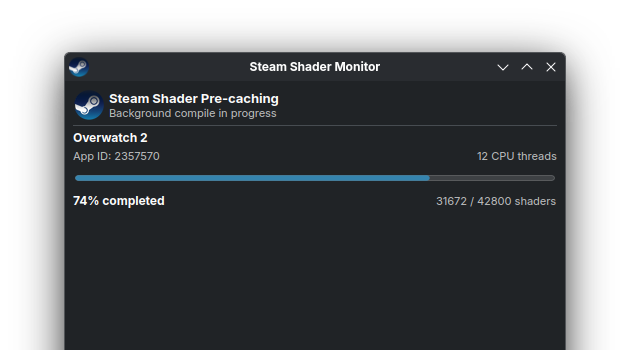
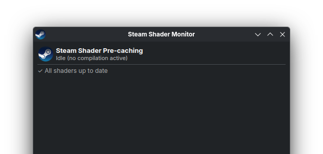

<div align="center">
  
  <h1>Steam Shader Monitor</h1>
  <p><strong>A lightweight KDE Plasma 6 widget monitoring background Steam Vulkan shader compilation.</strong></p>

  <p>
    
    
  </p>
</div>

---

## Overview

When Steam downloads Vulkan shader pre-caching packages, it processes and compiles the pipelines in the background across your CPU threads using `fossilize_replay`. Steam's GUI gives little to no visibility into this work once network downloads finish: the Downloads queue clears to 0 while your CPU is heavily compiling.

**Steam Shader Monitor** brings full visibility right to your KDE panel, status tray, or desktop.

<div align="center">
  
  
</div>

---

## Features

- **Panel & System Tray Indicator:**
  - **Idle:** Dimmed Steam icon when no shader compilation is running.
  - **Active:** Lights up with live percentage completion (e.g., `Steam 74%`).
- **Hover Tooltip:** Shows the currently compiling game title and pipeline counts at a glance.
- **Click Popup Dashboard:**
  - Real game title (e.g., *Overwatch 2*, *HELLDIVERS™ 2*) & Steam App ID
  - Smooth animated progress bar
  - Compiled vs. total pipeline counts
  - Active CPU thread count allocated to Fossilize
- **Lightweight & Efficient:** Pure QML frontend calling a fast (~30ms) Python helper that inspects Steam's local logs and process table without CPU overhead.

---

## Requirements

- **KDE Plasma 6**
- **Python 3**
- **Steam** (Native Linux client)

---

## Installation

### Method 1: Using `kpackagetool6` (Recommended)

```bash
git clone https://github.com/knot2006/plasma-applet-steam-shader-monitor.git
cd plasma-applet-steam-shader-monitor
kpackagetool6 -t Plasma/Applet -i .
```

To update in the future:
```bash
kpackagetool6 -t Plasma/Applet -u .
```

### Method 2: Manual Installation

Copy into your local Plasma plasmoids directory:

```bash
mkdir -p ~/.local/share/plasma/plasmoids/
cp -r plasma-applet-steam-shader-monitor ~/.local/share/plasma/plasmoids/org.kde.plasma.steamshaders
```

Then add the widget:
1. Right-click your KDE panel or desktop &rarr; **Add Widgets...** (or enter Edit Mode).
2. Search for **Steam Shader Monitor**.
3. Drag and drop it onto your panel or system tray.

---

## Testing / Simulation

To test the widget UI and animations without waiting for an actual game update, you can run:

```bash
python3 -c '
import time, json, os

total = 42800
steps = [5, 15, 30, 48, 65, 80, 92, 100]

for pct in steps:
    with open("/tmp/steam_shader_mock.json", "w") as f:
        json.dump({
            "active": True,
            "game": "Overwatch 2",
            "app_id": "2357570",
            "percent": pct,
            "counts": f"{int(total * pct / 100)} / {total}",
            "threads": 12,
            "status": f"{pct}%"
        }, f)
    time.sleep(2)

time.sleep(2)
if os.path.exists("/tmp/steam_shader_mock.json"):
    os.remove("/tmp/steam_shader_mock.json")
'
```

---

## License

[MIT](LICENSE) © Knot
